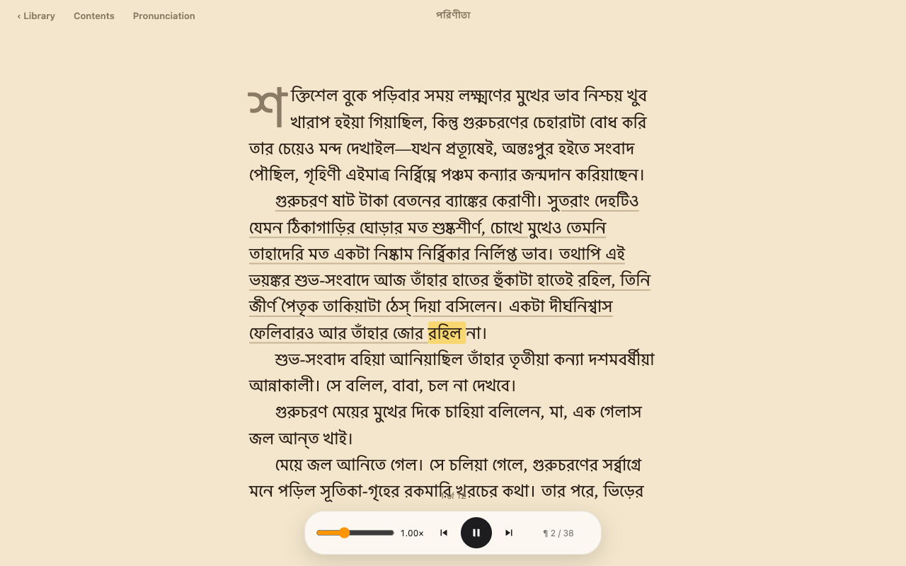

# Bangla audiobook reader for Mac (offline)

Turn any Bangla or English ebook into an audiobook on your Mac. It reads aloud and highlights each word as it's spoken.
Everything runs on your machine's GPU: no cloud, no account, no API key. Audio is generated as you listen and never written to disk.



**Hear it:** [assets/demo_bn.m4a](assets/demo_bn.m4a), the opening of Sarat Chandra's *পরিণীতা* (17 s, generated on an M2 Mac).

## What it does

- Library view for a folder of books: PDF, EPUB, MOBI, AZW3, FB2, TXT. Covers, collections, and per-book reading progress.
- Bangla paragraphs are voiced by [OmniVoice](https://github.com/k2-fsa/OmniVoice) running on MLX. English paragraphs use [Kokoro](https://github.com/hexgrad/kokoro).
  Mixed-language books work: each paragraph goes to the right engine.
- Word-by-word highlighting, click any paragraph to jump there, adjustable speed, a chapter list.
- Per-book pronunciation fixes for names the voice gets wrong.
- Optional (English only): character voices for dialogue, if [Ollama](https://ollama.com) is running locally.

## Speed

OmniVoice is a diffusion TTS model, and out of the box it is too slow to keep up with listening on a laptop.
This project uses a [patched OmniVoice-MLX](https://github.com/Karikari1234/OmniVoice-MLX/tree/speedup-bangla) that caches the text/reference prefix, reuses the classifier-free-guidance pass, and samples on the GPU.
Real-time factor (seconds of compute per second of audio, lower is faster) on Bangla, M2, 16 GB:

| Setting | RTF |
|---|---|
| Stock, 24 steps | 0.95 |
| 16 steps + prefix cache | 0.61 |
| + reuse guidance every 2 steps | 0.50 |
| + reuse guidance every 4 steps (used here) | **0.41** |
| Kokoro (English), for comparison | 0.20 |

At 0.41, the next paragraph is ready well before you finish the current one.
Details of each technique: [docs/mlx-speedups.md](https://github.com/Karikari1234/OmniVoice-MLX/blob/speedup-bangla/docs/mlx-speedups.md).

## Requirements

- Mac with Apple Silicon (M1 or newer). 16 GB RAM recommended.
- [Homebrew](https://brew.sh).
- About 5 GB of disk: two Python environments plus the 1.4 GB Bangla model.

## Install

```bash
git clone https://github.com/Karikari1234/bangla-audiobook-reader
cd bangla-audiobook-reader
./setup.sh
```

`setup.sh` installs `uv` and `espeak-ng` if missing. It creates `.venv` (app + Kokoro) and `.venv-omni` (OmniVoice-MLX), then downloads [mlx-community/OmniVoice-8bit](https://huggingface.co/mlx-community/OmniVoice-8bit).

## Use

```bash
./run.sh ~/Books
```

Put books in that folder (default `~/Books`); new files show up on refresh. The browser opens at http://localhost:8766.
Press Space to play or pause.

Need a Bangla book to try? Public-domain classics are on [bn.wikisource.org](https://bn.wikisource.org). Save chapters as a `.txt` file with blank lines between paragraphs.

Options:

| Env / arg | Default | |
|---|---|---|
| `./run.sh <books_dir> <port>` | `~/Books`, `8766` | |
| `OMNIVOICE_MODEL` | `mlx-community/OmniVoice-8bit` | local folder or Hugging Face id |
| `OMNIVOICE_PYTHON` | `.venv-omni/bin/python` | Python that has OmniVoice-MLX installed |
| `READALONG_LLM` | `qwen3.5:2b` | Ollama model for English character voices |

## How it works

`library_server.py` is a small standard-library HTTP server. It parses books, serves `library.html`, and runs Kokoro in-process.
Bangla text (detected by script) goes to `omni_worker.py`, a long-lived subprocess in the OmniVoice environment. It's kept separate because the two engines need different dependency sets.
The worker speaks each sentence with a fixed narrator voice (`assets/voice_bn.wav`), then returns WAV audio plus word timings as JSON.
OmniVoice gives no word timestamps, so each sentence's duration is split across its words by length.
State (progress, collections, covers, parse cache) lives in `./data`.

The narrator voice is synthetic: it was made with OmniVoice's voice-design mode (`female, middle-aged, moderate pitch`). It is not a recording of any real person.

## Limits

- macOS on Apple Silicon only. MLX doesn't run elsewhere.
- Bangla word highlighting is approximate (see above). English timings come from Kokoro and are exact.
- Scanned PDFs need OCR first. Only text PDFs are read.
- The first Bangla paragraph waits for the model to load, a few seconds.

## Credits

- [OmniVoice](https://github.com/k2-fsa/OmniVoice) (k2-fsa), Apache-2.0
- [OmniVoice-MLX](https://github.com/ailuntx/OmniVoice-MLX) (ailuntx), Apache-2.0. The speedups were sent upstream as [ailuntx/OmniVoice-MLX#1](https://github.com/ailuntx/OmniVoice-MLX/pull/1).
- [mlx-community/OmniVoice-8bit](https://huggingface.co/mlx-community/OmniVoice-8bit), Apache-2.0
- [Kokoro](https://github.com/hexgrad/kokoro) (hexgrad), Apache-2.0
- Demo text: *পরিণীতা* by Sarat Chandra Chattopadhyay (public domain), via Bengali Wikisource.

## License

MIT, see [LICENSE](LICENSE). Models and libraries keep their own licenses.
